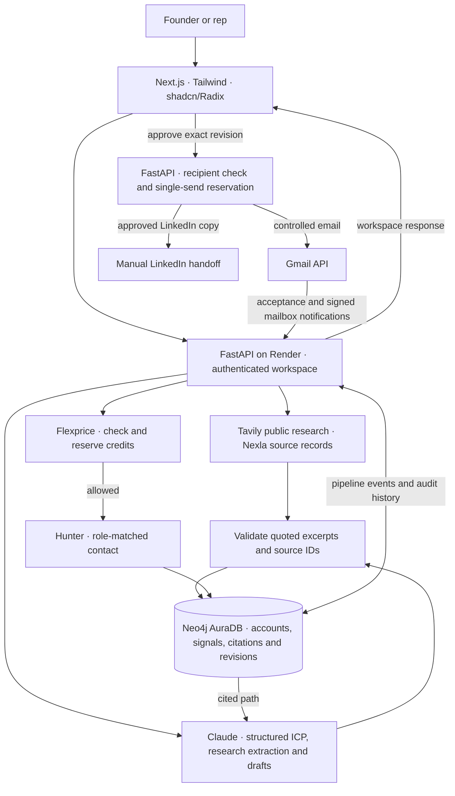

# Signal

Signal helps a B2B founder answer three questions before reaching out to a buyer. Why this company? Why now? Which source supports the opening line? In the HackwithBay demo, GeoFlow sells site-analysis software to renewable energy developers. A rep can follow a project announcement from its public excerpt to a product match, review the resulting email, and see which approved revision moved the deal into the pipeline.

**[Open Signal on Render](https://signal-gtm.onrender.com/)** · [Watch the 2:32 demo](https://drive.google.com/file/d/1PIK9R0OzVHW8Rie1fASEZQz6TQf3v6jD/view) · [System design and graph queries](docs/architecture.md) · [Sponsor checklist](docs/sponsor-requirements.md). Judges land directly on Home in a private browser copy of the saved GeoFlow workspace. Edits stay in that copy. The app uses its configured live integrations.

## What makes Signal different

- **A reason to act or wait.** A company can match the target industry and still have a Hold verdict. Fit, intent, negative evidence, and source dates stay attached to the account so the rep can inspect that decision.
- **A claim the rep can trace.** The Writing Agent and document editor share the account’s saved evidence. Generating outreach retrieves a live Neo4j path. Editing the copy creates a new revision, and sending requires approval of that exact revision and controlled recipient.
- **A measurable handoff.** A confirmed Gmail send records the requester, revision, channel, and pipeline event. Flexprice can allocate enrichment, graph lookup, and outreach costs to the same lead. Founders can compare conversion across industries, tiers, and message variants.

## Architecture



FastAPI owns graph mutations and provider credentials. Evidence checks run before saving generated claims. A Neo4j transaction reserves each approved send before the provider call. Workspace and pipeline updates use its recorded outcome. Band Desktop coordinated the team’s private implementation case. GitHub Actions runs tests, builds the UI, and scans the application. [Query patterns, approval rules and feedback processing](docs/architecture.md)

## Requirements and verification

On November 24, 2026, the public judge workspace opened with approved GeoFlow profile revision 5, **113 distinct company domains, 492 citations, 113 saved account paths and 30 Hunter-verified buyer contacts**. To follow one example, open **Accounts → Clearway Energy Group**, inspect its cited battery-storage announcement and buyer role, then open its draft in **Outreach**. [Company announcement](https://www.clearwayenergygroup.com/press-releases/clearway-and-pacificorp-sign-additional-210-mw-of-battery-energy-storage-in-utah/)

| Sponsor module | What judges can inspect |
| --- | --- |
| **1. Product intake and ideal customer profile** | Intake chat and the editable form capture capabilities, technical constraints, customer examples and wins, pricing model and contract value. The resulting profile covers NAICS/SIC classification, geography, headcount and revenue bands, buyer titles, seniority, buying triggers and exclusions. Each inferred field has a confidence score from 0 to 1. A founder can accept, edit or dismiss a cited adjacent segment and approve the profile revision used for discovery. [Profile](frontend/src/app/profile/page.tsx) |
| **2. Buyer and competitor discovery** | Tavily and Nexla supply public evidence. Each account links to source excerpts. The judge workspace contains 481 company-source citations, including company press releases, and 11 job-source citations. Research can also target filings. Fit combines industry, size, product need and geography on a 0–100 scale. Intent scores signal strength and recency. Together with exclusions, these produce Tier A/Contact, B/Hold and C/Reject. The snapshot has 31 Contact, 81 Hold and one Reject. Controlled tests cover direct, indirect and alternative competitors, including cited positioning, technical differences, and published plans or prices. [Discovery](backend/signal_app/research.py) · [Workflow tests](backend/tests/test_workflow.py) |
| **3. Dynamic knowledge graph** | Follow Product → Company → Signal → Evidence in Neo4j to see why an account matches and which excerpt supports the draft. The ontology also records people, competitors, current and prior employment, outreach and replies. Controlled tests exercise shared employer or school introductions, job-linked buying evaluations, and vendor renewal or churn. The operator workspace is configured for daily research refresh. [Graph schema and queries](docs/architecture.md#graph-ontology-and-queries) |
| **4. Contact enrichment and reviewed outreach** | Hunter resolves role-matched business contacts. The judge workspace includes 30 verified results, four uncertain results, and provider-supplied examples of MX and headquarters data. Prospect emails are masked. Signal drafts an initial email, a follow-up email and a LinkedIn message using the buyer’s role, a cited trigger, the product’s value and a call to action. Reps can edit, approve or reject each revision. Edits require fresh approval before scheduling or sending. Gmail delivered an approved message to the controlled test inbox. LinkedIn uses a reviewed manual handoff. [Provider adapter](backend/signal_app/providers.py) · [Approval and dispatch](docs/architecture.md#enrichment-approval-and-dispatch) |
| **5. Lead management and analytics** | The Kanban moves from Matched through Contacted, Replied and Meeting Booked to Closed/Lost. Events identify the rep or automation, time, channel and applicable revision. Judges start with 31 Matched leads. Analytics compare stage conversion by industry and tier, and group outcomes by assigned message variant, channel and value proposition. The hosted service accepted a signed Gmail mailbox notification. Controlled tests cover reply and bounce attribution. [Pipeline](frontend/src/app/pipeline/page.tsx) · [Gmail feedback tests](backend/tests/test_gmail_push.py) |

The Next.js, Tailwind and shadcn/Radix interface brings the account grid, knowledge graph, review queue and Kanban into one workspace. The grid shows fit and contact verification status. Account details show intent, tier and source evidence. The collapsible activity feed shows saved research, graph traversal, validation and review events. [Account grid](frontend/src/components/accounts-table.tsx) · [Graph explorer](frontend/src/app/graph/page.tsx)

### Sponsor integrations

| Integration | Verified result |
| --- | --- |
| **Band Desktop** | In the team’s private case, Planner/Architect, Builder, Reviewer and Security coordinated through 27 routed mentions across 46 messages. The room recorded human checkpoints for a schema decision and a dispatch hold, along with per-session tokens and estimated cost. All 12 fixture assertions passed. [Team verification record](PLAN.md#progress-on-main) |
| **Flexprice** | The live Sandbox accepted `leads_enriched`, `graph_query_evaluated` and `outreach_sent`. A low balance blocked enrichment before the Hunter call. The ledger allocated 1.15 credits across the three operations for one lead. [Metering and credits](docs/architecture.md#feedback-analytics-and-credits) |
| **Snyk** | GitHub Actions passed Snyk Code static analysis and separate dependency scans for the Python backend and JavaScript frontend. The same run passed 50 backend tests, frontend lint and the production build. [Workflow](.github/workflows/verify.yml) · [Passing scan and test results](https://github.com/hiromaruyama/hackathon-hackw-bay4.0/actions/runs/45516969309) |

### Submission deliverables

| Deliverable | Where to look |
| --- | --- |
| Hosted prototype | Open a private copy of the GeoFlow workspace directly from the [public demo](https://signal-gtm.onrender.com/). |
| Public source and setup | The [source repository](https://github.com/hiromaruyama/hackathon-hackw-bay4.0) includes [local setup](#run-locally) and [provider configuration](backend/README.md). |
| Narrated demo | The [2:32 walkthrough](https://drive.google.com/file/d/1PIK9R0OzVHW8Rie1fASEZQz6TQf3v6jD/view) follows a buyer from the Home assistant to the graph, original buying signal, Writing Agent and matched pipeline record. |
| System design | The [architecture document](docs/architecture.md) covers query logic, graph ontology, the evidence-to-draft flow, approval, provider feedback and integrations. The [API contract](docs/api-contract.md) includes a sample workspace. |

The team also exercised the full intake-to-pipeline flow in a browser against FastAPI and a disposable Neo4j database with simulated provider responses. That run covered editing and reapproving a draft, confirming a test send and reloading the resulting pipeline change. [Verification record](PLAN.md#progress-on-main) · [Sponsor checklist](docs/sponsor-requirements.md)

## Run locally

Use Python 3.12, Node.js 22, and a Neo4j database. From the repo root, install the backend and create the ignored environment file.

```sh
python3.12 -m venv backend/.venv
backend/.venv/bin/python -m pip install -r backend/requirements-dev.txt
cp -n backend/.env.example backend/.env
```

Fill the local environment file using the [provider setup](backend/README.md). Set a demo password, session secret, and Neo4j connection before opening the workspace. Build the frontend and start the app.

```sh
(cd frontend && npm ci && npm run build)
(cd backend && .venv/bin/python -m uvicorn signal_app.main:app --host 127.0.0.1 --port 8000)
```

Open [Signal on localhost](http://localhost:8000) and sign in. On the Profile page, start with the intake chat or enter the product directly. Approve the proposed profile, then open Accounts and include targeted regulatory filings and job postings if needed. Account details show the supporting sources and Neo4j paths. Generate and independently review each outreach step. The Pipeline page tracks Gmail confirmations, controlled-mailbox feedback, rep actions, and conversion data.

## Verify and deploy

- [Architecture and safety controls](docs/architecture.md) explains the graph, reasoning, scheduling, approval, and attribution.
- [API contract and fixture](docs/api-contract.md) describe the request and response shapes.
- [Backend tests and Render setup](backend/README.md) cover disposable Neo4j, provider configuration, and the single-service deployment.
- [PLAN.md](PLAN.md) tracks the sponsor requirements and verification evidence.

Set Render secrets through the service's environment settings. The Blueprint uses free Docker compute, the `/api/health` endpoint, and a daily research interval. Set `SIGNAL_RENDER_URL` as a GitHub Actions repository variable to wake a sleeping free service for its scheduled research. Judges can use the public URL immediately. The Docker image enables `SIGNAL_PUBLIC_JUDGE_ACCESS`. Set it to `false` for an operator-only deployment. Team members can open `/?operator=1` and enter the operator password to manage the original records.

### Snyk CI

Enable Snyk Code in the scanner organization and set `SNYK_ORG` to its ID or slug under the repository's **Settings → Secrets and variables → Actions → Variables**. Save the organization's CI scanner credential as the `SNYK_TOKEN` Actions repository secret. [Snyk CLI authentication](https://docs.snyk.io/developer-tools/snyk-cli/authenticate-to-use-the-cli) · [GitHub Actions secrets](https://docs.github.com/en/actions/how-tos/write-workflows/choose-what-workflows-do/use-secrets)

Run **Verify Signal** from the Actions tab. Its Snyk job reports backend and frontend dependency scans and Snyk Code in separate steps. Finding-related scan failures remain visible in the check results.
