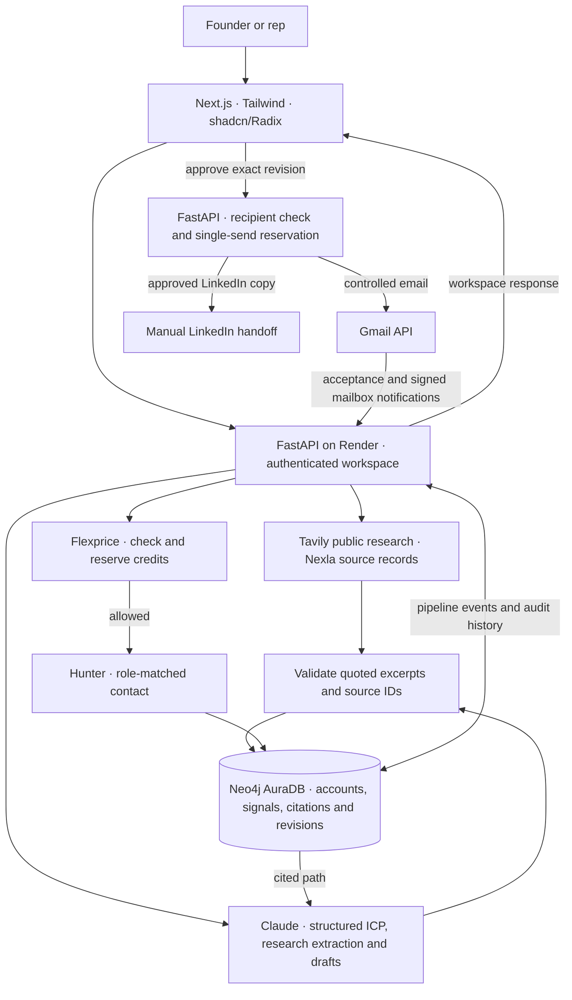

# Signal

Signal helps a B2B founder answer three questions before reaching out to a buyer. Why this company? Why now? Which source supports the opening line? In the HackwithBay demo, GeoFlow sells site-analysis software to renewable energy developers. A rep can follow a project announcement from its public excerpt to a product match, review the resulting email, and see which approved revision moved the deal into the pipeline.

**[Open Signal on Render](https://signal-gtm.onrender.com/)** · [System design and graph queries](docs/architecture.md) · [Sponsor checklist](docs/sponsor-requirements.md). The team shares demo credentials privately.

## What makes Signal different

- **A reason to act or wait.** A company can match the target industry and still have a Hold verdict. Fit, intent, negative evidence, and source dates stay attached to the account so the rep can inspect that decision.
- **A claim the rep can trace.** The Writing Agent and document editor share the account’s saved evidence. Generating outreach retrieves a live Neo4j path. Editing the copy creates a new revision, and sending requires approval of that exact revision and controlled recipient.
- **A measurable handoff.** A confirmed Gmail send records the requester, revision, channel, and pipeline event. Flexprice can allocate enrichment, graph lookup, and outreach costs to the same lead. Founders can compare conversion across industries, tiers, and message variants.

## Architecture



FastAPI owns graph mutations and provider credentials. Evidence checks run before saving generated claims. A Neo4j transaction reserves each approved send before the provider call. Workspace and pipeline updates use its recorded outcome. Band Desktop coordinated the team’s private implementation case. GitHub Actions runs tests, builds the UI, and scans the application. [Query patterns, approval rules and feedback processing](docs/architecture.md)

## Requirements and verification

The November 24, 2026 hosted audit read existing data. It found **113 distinct company domains, 492 citations and 113 saved account paths**. The final controlled run used the real UI, FastAPI and disposable Neo4j with simulated provider responses. It covered intake, approval, discovery, graph-to-draft navigation, edit and reapproval, controlled email confirmation, and a persisted pipeline transition. The 46 backend tests, frontend lint, production build and all three Snyk scans passed. [Workflow tests](backend/tests/test_workflow.py) · [CI results](https://github.com/hiromaruyama/hackathon-hackw-bay4.0/actions/runs/45514106527)

| Sponsor requirement | Evidence and remaining gaps |
| --- | --- |
| Product intake and ICP | Chat and the editable brief capture features, constraints, customer wins, pricing and contract value. ICP revisions include NAICS/SIC, firmographics, titles, seniority, triggers, exclusions and 0–1 field confidence. The hosted profile included a validated industry code and cited expansion. Controlled checks covered approval and accepting, editing or dismissing the proposed segment. [Profile](frontend/src/app/profile/page.tsx) · [Classification and workflow tests](backend/tests/test_workflow.py) |
| Buyer discovery and exclusions | Approved-profile discovery matches role, scores evidence and deduplicates domains. The snapshot contained 31 Contact, 81 Hold and one Reject, with 481 company-source and 11 job-source citations. Filing and press-source coverage still needs independent live proof in this dataset. [Discovery and source validation](backend/signal_app/research.py) |
| Competition | Direct, indirect and alternative comparisons carry cited positioning, differences and any published pricing or packaging. Controlled tests covered all three classes. An earlier live pass found one direct competitor with unknown pricing. The audited workspace had zero competitor records. [Competitor and multi-hop tests](backend/tests/test_workflow.py) |
| Native graph, inference and freshness | Neo4j stores Company, Person, Product, Competitor and Signal with directed matching, employment, prior employment, competition, contact and reply edges. Controlled queries exercised employment, education, possible introductions, job-linked evaluations, renewal and churn. The hosted snapshot had zero advanced records. The daily refresh interval was configured and the scheduled-claim test passed. A completed provider-backed scheduled cycle remains unverified. [Ontology and queries](docs/architecture.md#graph-ontology-and-queries) |
| Contact enrichment | Hunter returned 30 verified and four uncertain results in the hosted snapshot. Another 17 lookups returned no match. The workspace recorded one MX value and one headquarters value. No validated personal LinkedIn URL was present. The adapter checks corporate domain and role alignment and masks email addresses. Independent verification of every corporate domain remains open. [Provider implementation](backend/signal_app/providers.py) · [Provider tests](backend/tests/test_providers.py) |
| Personalized outreach and approval | Email and LinkedIn steps use saved signals, buyer role, value proposition, length limits and a requested call to action. Reviews bind each revision and recipient. Hold and Reject accounts support writing-only drafts. A previous approved Gmail test reached the controlled inbox. LinkedIn supports reviewed manual handoff. Direct delivery needs a Messages API grant. [Review, scheduling and send tests](backend/tests/test_workflow.py) |
| Pipeline, attribution and analytics | Kanban tracks Matched, Contacted, Replied, Meeting Booked and Closed/Lost. The dashboard exposes industry, tier, template variant, channel and value-proposition breakdowns. Stored events distinguish provider confirmation from rep actions and record time and revision. The hosted app accepted a signed Gmail push. Correlation of an actual reply or bounce to a controlled send remains unverified. [Pipeline](frontend/src/app/pipeline/page.tsx) · [Gmail push tests](backend/tests/test_gmail_push.py) |
| Workspace interface | The account grid shows Fit and enrichment status. Home shows drafts awaiting review, recent buying signals and pipeline changes. **Ask about tasks in Agents tab** opens the separate Agent conversation. Workspace pages without an embedded agent offer a bottom-right Ask Signal popup. Account, graph and profile views expose intent, tiers, evidence and field confidence. The activity sheet polls saved research, traversal, validation and review events while open. The verdict-first graph passed browser checks at 1440, 390 and 320 pixels. Numeric enrichment confidence in grid cells remains an open requirement. [Account grid](frontend/src/components/accounts-table.tsx) · [Verdict graph](frontend/src/app/graph/page.tsx) |
| Band Desktop bonus | Four agents performed planner, builder, reviewer and security roles. The private case recorded 27 routed mentions across 46 messages, token and cost telemetry, an owner schema checkpoint and a dispatch hold. All 12 fixture assertions passed. [Team verification record](PLAN.md#progress-on-main) |
| Flexprice bonus | The live Sandbox accepted leads enriched, graph queries evaluated and outreach sent. A low balance blocked the Hunter call. The recorded allocation was 1.15 credits for one lead across the three operations. [Metering and credit tests](backend/tests/test_workflow.py) |
| Snyk bonus | Main-branch CI runs dependency scans on the Python backend and JavaScript frontend and Snyk Code on the application. The same workflow runs backend tests with Neo4j, frontend lint and a production build. [Verification workflow](.github/workflows/verify.yml) · [Run results](https://github.com/hiromaruyama/hackathon-hackw-bay4.0/actions/runs/45514106527) |

The public repository includes setup, a hosted end-to-end prototype and the system design. The team holds the private **2:32 narrated demo** for judges. It shows intake through dashboard synchronization with simulated provider responses. [Deployment](https://signal-gtm.onrender.com/) · [Architecture document](docs/architecture.md) · [API contract and fixture](docs/api-contract.md)

## Run locally

Use Python 3.12, Node.js 22, and a Neo4j database. From the repo root, install the backend and create the ignored environment file.

```sh
python3.12 -m venv backend/.venv
backend/.venv/bin/python -m pip install -r backend/requirements-dev.txt
cp -n backend/.env.example backend/.env
```

Fill the local environment file using the [provider setup](backend/README.md). Set a demo password, session secret, and Neo4j connection before opening the workspace. Build the frontend and start the app.

```sh
(cd frontend && npm ci && npm run build)
(cd backend && .venv/bin/python -m uvicorn signal_app.main:app --host 127.0.0.1 --port 8000)
```

Open [Signal on localhost](http://localhost:8000) and sign in. On the Profile page, start with the intake chat or enter the product directly. Approve the proposed profile, then open Accounts and include targeted regulatory filings and job postings if needed. Account details show the supporting sources and Neo4j paths. Generate and independently review each outreach step. The Pipeline page tracks Gmail confirmations, controlled-mailbox feedback, rep actions, and conversion data.

## Verify and deploy

- [Architecture and safety controls](docs/architecture.md) explains the graph, reasoning, scheduling, approval, and attribution.
- [API contract and fixture](docs/api-contract.md) describe the request and response shapes.
- [Backend tests and Render setup](backend/README.md) cover disposable Neo4j, provider configuration, and the single-service deployment.
- [PLAN.md](PLAN.md) tracks the sponsor requirements and verification evidence.

Set Render secrets through the service's environment settings. The Blueprint uses free Docker compute, the `/api/health` endpoint, and a daily research interval. Set `SIGNAL_RENDER_URL` as a GitHub Actions repository variable to wake a sleeping free service for its scheduled research. Give judges the demo password privately.

### Snyk CI

Enable Snyk Code in the scanner organization and set `SNYK_ORG` to its ID or slug under the repository's **Settings → Secrets and variables → Actions → Variables**. Save the organization's CI scanner credential as the `SNYK_TOKEN` Actions repository secret. [Snyk CLI authentication](https://docs.snyk.io/developer-tools/snyk-cli/authenticate-to-use-the-cli) · [GitHub Actions secrets](https://docs.github.com/en/actions/how-tos/write-workflows/choose-what-workflows-do/use-secrets)

Run **Verify Signal** from the Actions tab. Its Snyk job reports backend and frontend dependency scans and Snyk Code in separate steps. Finding-related scan failures remain visible in the check results.
