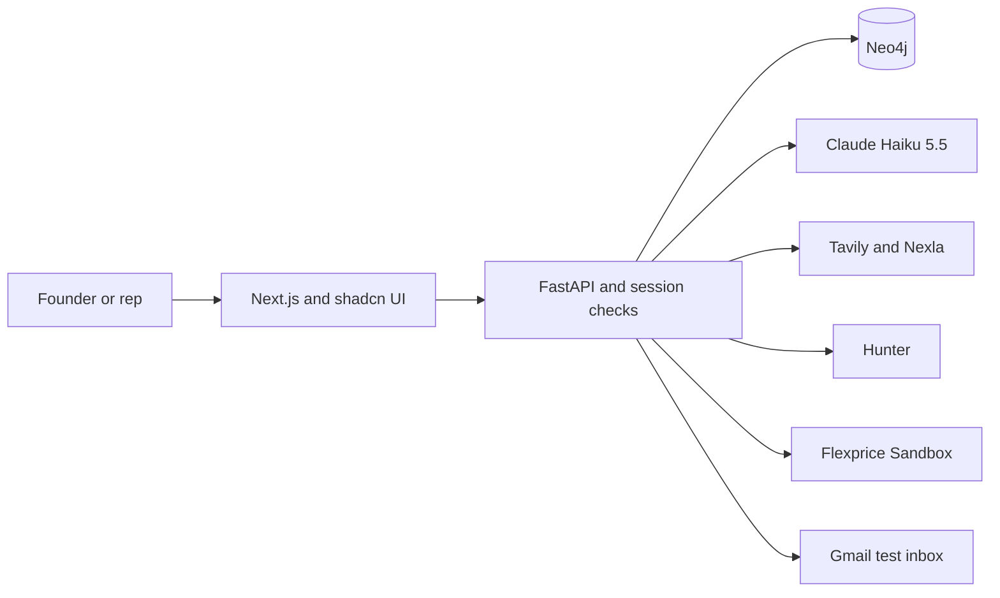

# Signal architecture

Signal serves a Next.js static export and a FastAPI API from one origin. Neo4j stores the workspace, evidence graph, revisions, approval decisions, dispatch reservations, usage events, and pipeline history. Production configuration and provider credentials stay in the backend environment.

## Intake and cited discovery

Intake chat prompts for product facts and missing details. Its output contains a reply and a typed proposal for the form. The founder applies the proposal before generating an ICP. The backend validates NAICS and SIC codes against the Census 2022 NAICS and SEC EDGAR SIC catalogs. Catalog titles are canonical. The founder can revise the codes, firmographics, buyer roles, triggers, and exclusions, then approve a new revision. Approval records the timestamp and actor.

Discovery uses the current approved revision. The backend deduplicates by normalized domain and retains public evidence before extraction. A standard pass runs a prospect search and a competitor search, plus one focused retry when evidence is thin. The selected filings and jobs option adds two targeted searches. Nexla contributes provisioned public records. The typed model extracts quotes and source IDs. The code verifies that the quote exists at its source and that the company or its domain is supported. Direct, indirect, and alternative competitor listings require cited positioning and differences. Prices require their own evidence.

Fit adds 35 points for supported industry alignment, 20 for company size, 35 for product need, and 10 for geography. Intent is 100 for a recent direct signal, 75 for a recent indirect signal, 50 for weak or stale evidence, and zero without a signal. Contact requires at least 70 fit and 75 intent and no exclusion. A cited hard exclusion results in Reject. Other accounts are held for review.

## Graph ontology and queries

All graph writes and reads are scoped to a workspace. Stable IDs link entities to saved evidence and ICP revisions.

| Relationship | Meaning |
| --- | --- |
| `Product → MATCHED_TO → Company` | A company was evaluated against an approved revision. Fit and recommendation are stored on the edge. |
| `Company → HAS_SIGNAL → Signal → EVIDENCED_BY → Evidence` | A claimed buying signal has a source excerpt. Draft generation traverses this path and verifies the returned evidence ID. |
| `Person → WORKS_AT → Company` | A Hunter result or a public employment excerpt identifies a buyer association. |
| `Person → PREVIOUSLY_EMPLOYED_AT → Company` and `Person → ALUMNI_OF → Institution` | A public excerpt explicitly names the person, current company, and previous employer or school. |
| `Product → COMPETES_WITH → Competitor` | A saved competitor comparison contains cited positioning and differentiation. |
| `Company → HAS_MARKET_SIGNAL → Signal → RELATES_TO → Competitor` | A cited job posting, contract renewal, or vendor replacement links a company to its reported situation. Buying-evaluation signals can omit the vendor. |
| `Company → CONTACTED_VIA → Interaction` and `Interaction → REPLIED_TO → Interaction` | A confirmed test send and an attributed reply form a timeline. |

The relationship explorer queries `Company ← WORKS_AT ← Person → PREVIOUSLY_EMPLOYED_AT or ALUMNI_OF ← Person → WORKS_AT → Company` and retrieves both source records. A shared affiliation suggests a possible introduction. Dates and excerpts let the rep assess whether it is relevant. Vendor paths require a quoted renewal or replacement and a named vendor. Source refresh updates active relationships and retains the underlying evidence.

Scheduled refresh uses the configured interval and the last completed or attempted run. A Neo4j write transaction reserves each due refresh. A Render health check can wake the service and let its worker process a due refresh. Refresh collects research and updates the graph. Outreach remains a signed-in review and dispatch workflow.

## Enrichment, approval, and dispatch

Before a Hunter request, the backend checks Flexprice and reserves the enrichment allowance. A low balance returns HTTP 402 before Hunter runs. The UI shows the provider’s actual verification and MX status when available. Only masked prospect email is persisted in the workspace. The draft uses the cited graph signal and product facts. Copy validation rejects ungrounded claims or substitutes a literal sourced template.

An initial email can be extended into a follow-up email and a LinkedIn message. Each step has its own exact revision and approval. An approved follow-up can record its earliest allowed action time. Editing or rejecting a step clears its schedule. Follow-ups require the prior confirmed email and pause after reply, bounce, or closing. The LinkedIn handoff records the approved text and controlled profile, leaving delivery confirmation to an approved provider integration.

The send route requires a valid session and configured origin. A Neo4j transaction locks and reads the draft, checks the current revision, snapshot, schedule, recipient, and suppression, then writes one reservation. The send route calls Gmail after commit. Provider acceptance saves one attempt result and the corresponding pipeline event together. Failure preserves the stage. An ambiguous outcome locks the draft for manual inbox review. The provider call has automatic retries disabled.

The same workspace write lock enforces the rolling hourly limit before reserving a new send. The default is six attempts. `SIGNAL_TEST_SEND_LIMIT_PER_HOUR` sets the limit. A repeated request reads an existing reservation. The pipeline identifies the confirmation as Gmail automation and retains the requesting rep and exact revision. Rep stage changes keep their own source and timestamp.

The intake and research models receive scoped text and typed schemas. Their output cannot call dispatch or mutate the graph directly. The application validates evidence and copy and executes fixed, parameterized queries. Outbound logs include actor, revision, time, and outcome. They omit the email content and credentials.

## Feedback, analytics, and credits

The Gmail feedback route reads metadata for recorded test messages with a separate `gmail.metadata` token. It verifies that a reply or bounce references the exact outbound message and corresponds to the test recipient. It stores a stable event ID for deduplication. The pipeline attributes provider feedback to Gmail and later stage changes to the signed-in rep. Authored notes are redacted before storage.

Authenticated Google Pub/Sub push uses the same Gmail feedback matcher. Google-signed JWTs must match the endpoint audience and dedicated push service account. Signal also checks the subscription and controlled sender mailbox in each request. An inbox watch uses the separate metadata OAuth grant and renews daily. Neo4j saves the last acknowledged history checkpoint with any new feedback events in one transaction. Replays acknowledge without recording a duplicate, and the scheduled history check catches missed notifications. [Gmail push setup](../backend/README.md#gmail-feedback-push)

Counts and conversion denominators use the stages a lead actually reached. Analytics can group by industry, tier, assigned message variant, delivery channel, and stated value proposition. The initial email variant is chosen deterministically per account and stored with the specific approved and sent revision. Demo test sends appear as test activity.

Flexprice receives stable IDs for `leads_enriched`, `graph_query_evaluated`, and `outreach_sent`. Each includes the lead's account ID for cost allocation. The UI shows recent meter outcomes, wallet balance, reserved allowance, and blocked enrichments.

## Verification boundaries

Browser workflow tests use a real FastAPI service and a disposable Neo4j database with labeled synthetic inputs and provider responses. Live checks verify the configured Haiku, Tavily, Nexla, Hunter, AuraDB, Gmail test inbox, read-only Gmail metadata token, and Flexprice Sandbox. The [progress table](../PLAN.md) records the status of hosted verification, LinkedIn delivery authorization, Band Desktop, and Snyk.
